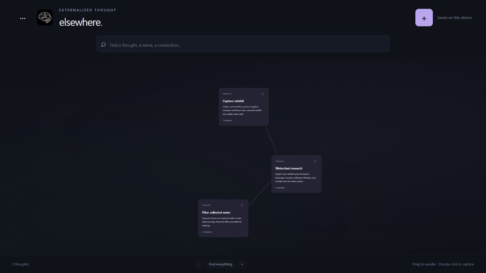

<p align="center">
  
</p>

<p align="center">
  <strong>A spatial home for thoughts, notes, and connections.</strong><br>
  Desktop application · Local storage · Optional phone access
</p>

<p align="center">
  <a href="#the-space">The space</a> &nbsp;·&nbsp;
  <a href="#your-devices">Your devices</a> &nbsp;·&nbsp;
  <a href="#agent-memory">Agent memory</a> &nbsp;·&nbsp;
  <a href="#build-from-source">Build from source</a>
</p>

---

## The space

Elsewhere gives ideas room to develop. Capture a thought, expand it into a note, or choose a reusable template when structure helps. Connections remain visible as the space grows.

Related thoughts gather into neighborhoods with stable anchors. Motion settles once the layout finds its balance. Changes arrive gradually, one at a time, while opening a thought pauses the movement for reading and editing.



<p align="center"><sub>Workspace preview with example content.</sub></p>

| Capture | Connect | Develop |
| --- | --- | --- |
| Add a thought, note, or template-based record. Changes save automatically. | Link ideas, follow relationships, and find related material in the space. | Add attachments, use checklists and fields, and revisit earlier revisions. |

The current layout uses local word-pattern similarity, explicit links, and optional categories. Model-based semantic grouping is not implemented.

## Your devices

The desktop app opens its own window and starts its Rust backend in the same process. The phone dashboard is another surface for that backend.

| Surface | Availability |
| --- | --- |
| **Windows desktop** | Local desktop build verified. |
| **macOS and Linux desktop** | Tauri source targets available; native packages have not been verified. |
| **Phone browser** | Responsive dashboard served by the desktop backend after pairing on the local network. |
| **Standalone Android** | Additional native client. ARM64 package builds locally; device testing remains outstanding. |

### Open the space on a phone

1. Open **Space options → Devices & data** in the desktop app.
2. Choose **Show phone connection**.
3. Scan the code or open the connection link on a phone on the same network.

Keep the desktop app open while using its phone dashboard. The connection link contains a per-run access token.

Independent native clients can also pair and exchange changes. Each retains a local copy, and competing revisions remain available for review.

## Agent memory

Agent memory and user knowledge are separate stores.

| User knowledge | Agent memory |
| --- | --- |
| Thoughts and notes in the main space. | Persistent records available to connected agents. |
| Used by the canvas, user search, backups, and peer exchange. | Stored in its own database and inspected through **Agent access**. |
| Not accessible through the agent memory endpoint. | Exposed through a local MCP endpoint with individually revocable connections. |

In **Space options → Agent access**, create a named connection and choose read-only or read/add/edit access. Copy the generated endpoint and bearer token into a compatible MCP client. The token is displayed once.

Available operations:

- Search agent memory and read individual records.
- Follow relationships and inspect revision history.
- Create and update memory records when write access is granted.
- Reject stale edits using revision checks and attribute changes to the connection.

The MCP endpoint binds to loopback. Hosted agents need a separate supported connection to reach it. Agent memory is excluded from user backups and peer exchange; a dedicated agent-memory backup flow is not implemented.

## Build from source

**Development preview · v0.2.0**

Install Rust, Node.js with npm, and the [Tauri platform prerequisites](https://v2.tauri.app/start/prerequisites/).

```sh
git clone https://github.com/dustindwayne/elsewhere.git
cd elsewhere
npm ci
npm run tauri -- dev
```

### Desktop

Build on the operating system you want to target:

```sh
npm run desktop:build
```

This builds the desktop application without an installer bundle. Compiled executables are written under `target/release/`.

### Android

Install the Android SDK, NDK, a compatible JDK, and the Rust Android target. Initialize the native project when required:

```sh
npm run android:init
npm run android:build
```

A Windows packaging helper is also available:

```powershell
./scripts/build-android.ps1
```

### Verify

```sh
npm test
```

The test suite covers record persistence, revision conflicts, attachments, agent isolation, authenticated phone sessions, peer exchange, spatial settling, and sequential visual updates.

<details>
<summary><strong>Architecture and data</strong></summary>

### Source map

| Directory | Responsibility |
| --- | --- |
| `core/` | Rust storage, revisions, templates, files, agent memory, HTTP backend, and peer transport. |
| `src-tauri/` | Desktop window, platform integration, icons, and Android client source. |
| `web/` | Bundled interface, phone dashboard, spatial simulation, and transitions. |
| `tests/` | Spatial behavior and visual sequencing tests. |

### Storage boundaries

```text
Application data/
├── elsewhere.db                User knowledge and application settings
└── agent-memory/
    └── elsewhere.db            Agent memory
```

Records are stored locally in SQLite. Attachments are deduplicated by content hash. Revision history preserves earlier content and conflicting edits.

Templates are inert, versioned data. Installed template packages require a valid signature and supported element types.

### Network and encryption

- The backend starts on loopback. Phone access enables a local-network listener with session authentication.
- Phone sessions use HttpOnly, SameSite cookies over HTTP; this dashboard connection is not encrypted by TLS.
- Native peer exchanges use authenticated encrypted packets.
- Agent connections use separate bearer tokens on a loopback MCP listener.
- SQLite databases are not encrypted at rest.

The backend development preview can be started with `npm run backend:dev`. The desktop application remains the primary executable.

No CI build workflow is included.

</details>
